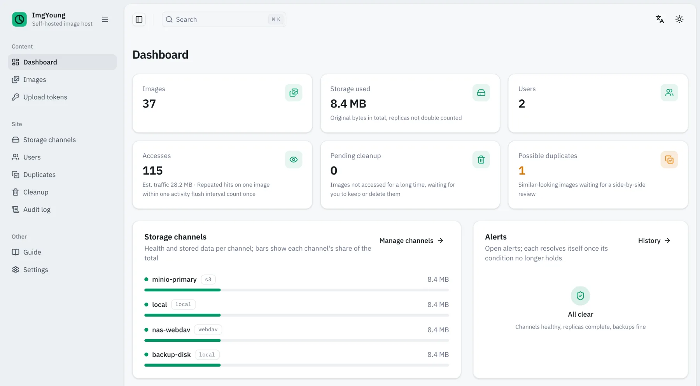
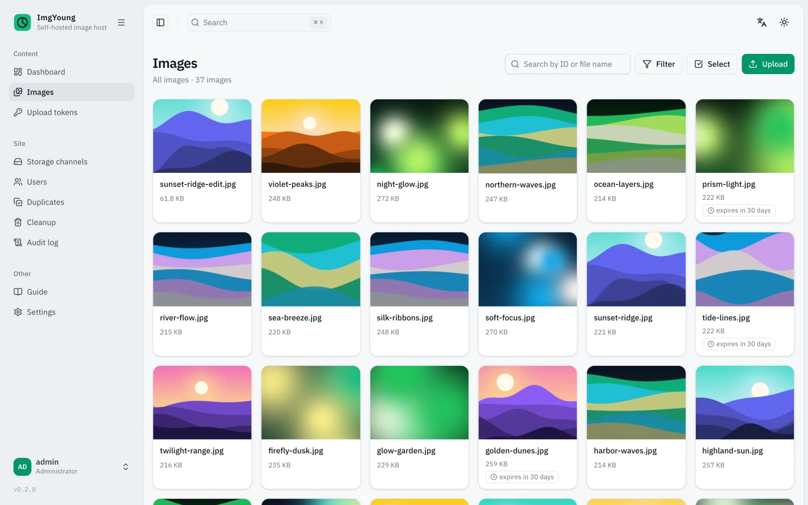
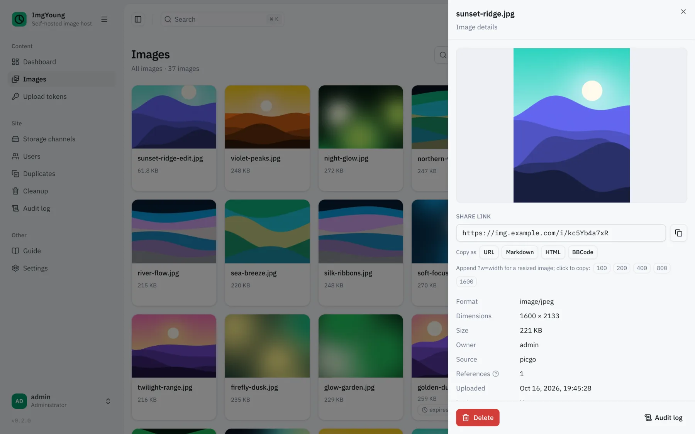
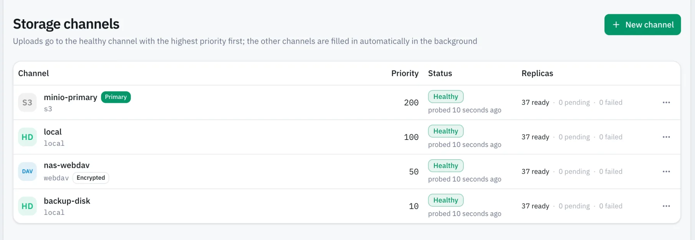
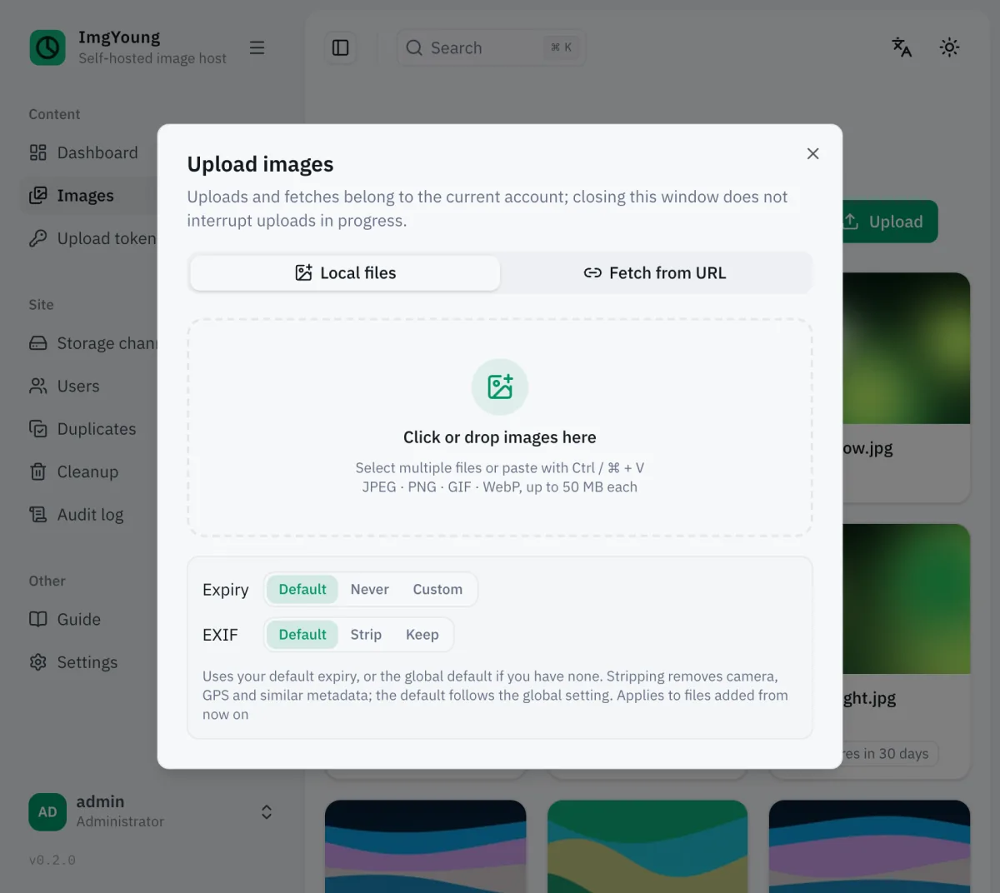
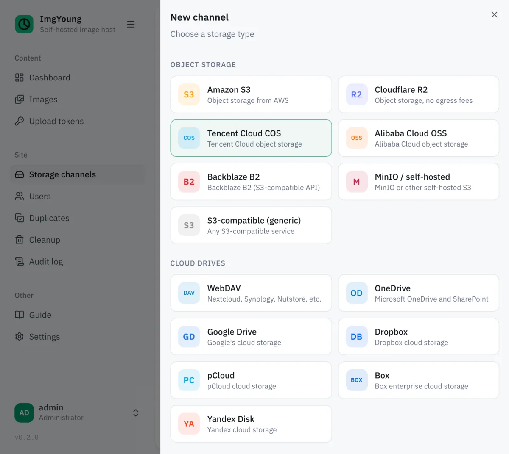

<p align="center">
  
</p>

<h1 align="center">ImgYoung</h1>

<p align="center">
  <strong>Self-hosted image hosting with multi-channel failover</strong><br>
  Every image is stored in several storage channels at once. When one of them fails, uploads and image links keep working.
</p>

<p align="center">
  <a href="https://github.com/x-haose/imgyoung/releases"></a>
  <a href="https://github.com/x-haose/imgyoung/actions/workflows/ci.yml"></a>
  <a href="./go.mod"></a>
  <a href="https://pkg.go.dev/github.com/x-haose/imgyoung"></a>
  <a href="https://hub.docker.com/r/haose/imgyoung"></a>
  <a href="./LICENSE"></a>
</p>

<p align="center">
  <a href="https://imgyoung.x-haose.com/en/docs">Docs</a> ·
  <a href="#quick-start">Quick start</a> ·
  <a href="https://github.com/x-haose/imgyoung/releases">Download</a> ·
  <a href="./README.md">简体中文</a>
</p>

<picture>
  <source media="(prefers-color-scheme: dark)" srcset="docs/public/screenshots/dashboard-en-dark.webp">
  
</picture>

## Why ImgYoung

When an image host loses your files, every link to them in blog posts, docs and chat history breaks at once. ImgYoung is built around one goal: images stay, and links keep working.

<table>
  <tr>
    <th width="33%">Images don't get lost</th>
    <th width="33%">Providers can't see your content</th>
    <th width="33%">Recover from a dead server</th>
  </tr>
  <tr>
    <td valign="top">Every image goes into several channels: object storage, cloud drives, a NAS, local disk, or any other rclone backend. When a channel fails, uploads move on to the next one, reads switch to a channel that still has a copy, and missing copies are filled in automatically.</td>
    <td valign="top">Channels can be encrypted: content and file names are encrypted before they are written. Keys derive from your master key, and with a channel's exported rclone config, stock rclone can read the originals without ImgYoung.</td>
    <td valign="top">The metadata database is snapshotted to every channel on a schedule. On a new machine, put back the master key and one snapshot, and every image and link comes back.</td>
  </tr>
</table>

## Features

- **Upload**: drag and drop or paste in the admin console, the HTTP API, URL import, and an S3-compatible API; PicGo, PicList and ShareX connect directly, and Typora connects through PicGo. The upload API accepts idempotency keys, so client retries never create duplicates.
- **Import**: give it a list of image URLs, Markdown or HTML text, or just a sitemap; the server scans out the images, you confirm which hosts to import, and it transfers them in bulk and exports a mapping from old links to new ones.
- **Serve**: short links `/i/<id>` can be cached by a CDN for a year; `?w=` resizes to preset widths and serves WebP to browsers that accept it; Referer allowlist against hotlinking; optionally 302 visitors to a channel's own public URL to save bandwidth.
- **Storage**: ready-made templates for common object storage and cloud drives, raw parameters for any other rclone backend; priority decides primary and backups; scheduled health checks demote failing channels and bring them back once they recover; optionally require N synchronous copies per upload.
- **Administration**: multiple users with storage quotas; named upload tokens with expiry, rotation and revocation; audit log, alerts and webhooks, Prometheus metrics; English and Simplified Chinese, light and dark themes.
- **Lifecycle**: per-image expiry with renew-on-access; images nobody has opened for a long time go to a cleanup queue; byte-identical images merge automatically, and look-alikes wait for an admin's decision.
- **Deployment**: one pure-Go binary with embedded SQLite, no external database or cache; Docker, Docker Compose, a one-line install script, and systemd; Linux, macOS and Windows on amd64 and arm64.

## Screenshots

<table>
  <tr>
    <td width="50%">
      <picture>
        <source media="(prefers-color-scheme: dark)" srcset="docs/public/screenshots/images-en-dark.webp">
        
      </picture>
      <p align="center">Images</p>
    </td>
    <td width="50%">
      <picture>
        <source media="(prefers-color-scheme: dark)" srcset="docs/public/screenshots/detail-en-dark.webp">
        
      </picture>
      <p align="center">Image details</p>
    </td>
  </tr>
  <tr>
    <td colspan="2">
      <picture>
        <source media="(prefers-color-scheme: dark)" srcset="docs/public/screenshots/channels-en-dark.webp">
        
      </picture>
      <p align="center">Storage channels</p>
    </td>
  </tr>
  <tr>
    <td width="50%">
      <picture>
        <source media="(prefers-color-scheme: dark)" srcset="docs/public/screenshots/upload-en-dark.webp">
        
      </picture>
      <p align="center">Upload</p>
    </td>
    <td width="50%">
      <picture>
        <source media="(prefers-color-scheme: dark)" srcset="docs/public/screenshots/new-channel-en-dark.webp">
        
      </picture>
      <p align="center">New channel</p>
    </td>
  </tr>
</table>

## Quick start

Run it with Docker:

```bash
docker run -d --name imgyoung --restart unless-stopped \
  -p 8721:8721 -v imgyoung-data:/data haose/imgyoung:latest
```

Or install it as a local program on Linux or macOS in one line, then run `imgyoung` to start it (on Linux, use `| sudo sh -s -- --service` instead to register a systemd service and start it right away):

```bash
curl -fsSL https://raw.githubusercontent.com/x-haose/imgyoung/main/install.sh | sh
```

Then:

1. Open `http://localhost:8721/`, sign in as `admin` with the initial password, and change the password when prompted. The initial password is printed in the log of the first start (with Docker: `docker logs imgyoung 2>&1 | grep 初始密码`), or you can set it with the `IMGYOUNG_ADMIN_PASSWORD` environment variable.
2. On the **Storage channels** page, add at least one off-site channel. A new instance has only the local disk as a channel; failover takes effect once an off-site channel is in place.
3. On the **Upload tokens** page, issue a token for PicGo / PicList, or upload directly:

```bash
curl -H "Authorization: Bearer <token>" -F "file=@photo.png" http://localhost:8721/api/upload
# {"id":"R0RjUyP1UW","url":"http://localhost:8721/i/R0RjUyP1UW"}
```

> [!NOTE]
> ImgYoung is at 0.x, and releases may include incompatible changes. Read the [release notes](https://github.com/x-haose/imgyoung/releases) before upgrading.

## Supported storage and clients

**Storage**: ready-made templates for Amazon S3, Cloudflare R2, Alibaba Cloud OSS, Tencent Cloud COS, Backblaze B2, MinIO and other S3-compatible services, WebDAV (Nutstore, Nextcloud, Synology and more), OneDrive, Google Drive, Dropbox, pCloud, Box and Yandex Disk; any other rclone backend can be added with raw parameters.

**Clients**: PicGo, PicList, ShareX, Typora, the aws CLI, rclone, S3 SDKs in any language, and curl or your own scripts. See [Upload clients](https://imgyoung.x-haose.com/en/docs/guides/clients) for setup.

## Documentation

The full documentation lives at <https://imgyoung.x-haose.com>:

| Section | Covers |
| --- | --- |
| [Installation](https://imgyoung.x-haose.com/en/docs/install) | One-line script, Docker, Docker Compose, release archives, building from source |
| [Guides](https://imgyoung.x-haose.com/en/docs/guides/upload) | Uploading, upload clients, accessing images, lifecycle and deduplication, the admin console |
| [Storage channels](https://imgyoung.x-haose.com/en/docs/channels) | Channels and failover, object storage and WebDAV, cloud drives and OAuth, channel encryption |
| [Configuration](https://imgyoung.x-haose.com/en/docs/configuration) | Environment variables and runtime settings |
| [Operations](https://imgyoung.x-haose.com/en/docs/operations/reverse-proxy) | Reverse proxy & HTTPS, CDN, backup & restore, upgrading, forgotten password, monitoring & alerts |
| [Architecture](https://imgyoung.x-haose.com/en/docs/architecture) | Design trade-offs and technology choices |
| [API reference](https://imgyoung.x-haose.com/en/docs/api) | Generated from [api/openapi.yaml](./api/openapi.yaml) |

Example deployments (Compose, Caddy, Nginx, systemd) are in [deploy/](./deploy/); planned work is tracked in issues labeled [`roadmap`](https://github.com/x-haose/imgyoung/issues?q=label%3Aroadmap).

## Using it as a Go library

The storage engine is a set of public Go packages you can use on their own: `store/driver` defines the storage driver interface, `store/rclone` implements it on any rclone backend (with optional encryption), and `store/failover` provides failover primitives over a set of drivers: write in priority order until N copies succeed, read from the first that can, health checks.

```bash
go get github.com/x-haose/imgyoung/store/failover github.com/x-haose/imgyoung/store/rclone
```

See the [Go library docs](https://imgyoung.x-haose.com/en/docs/library) for usage and examples, and [pkg.go.dev](https://pkg.go.dev/github.com/x-haose/imgyoung) for the API of each package.

## Contributing

```bash
task test   # all tests, with the race detector
task e2e    # end-to-end tests: build the real binary, start it, and validate every response against the OpenAPI document
task lint   # Go, admin console, docs site and install script checks; zero issues required
task docs   # preview the docs site locally
```

Environment setup, conventions, commits and the release process are described in [CONTRIBUTING.en.md](./CONTRIBUTING.en.md). Issues and pull requests are welcome, and if ImgYoung is useful to you, a star helps too.

## Acknowledgements

ImgYoung is built on these open-source projects: [rclone](https://rclone.org/) (storage backends and encryption), [River](https://riverqueue.com/) (job queue), [modernc.org/sqlite](https://gitlab.com/cznic/sqlite) (pure-Go SQLite), [Atlas](https://atlasgo.io/) (database migrations), and [chi](https://github.com/go-chi/chi) (HTTP routing). The admin console is built with [TanStack](https://tanstack.com/) and [shadcn/ui](https://ui.shadcn.com/) and reuses generic components from [shadcn-admin](https://github.com/satnaing/shadcn-admin); the docs site is built with [Fumadocs](https://fumadocs.dev/).

## License

[MIT](./LICENSE). The license for the shadcn-admin components is at [web/licenses/shadcn-admin.LICENSE](./web/licenses/shadcn-admin.LICENSE).
