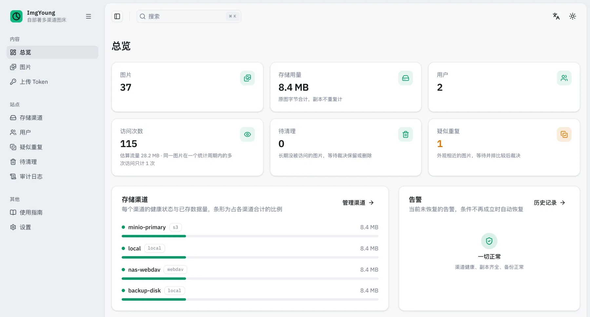
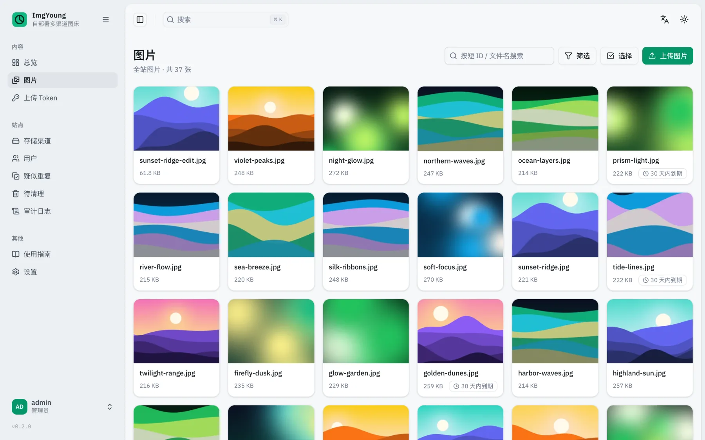
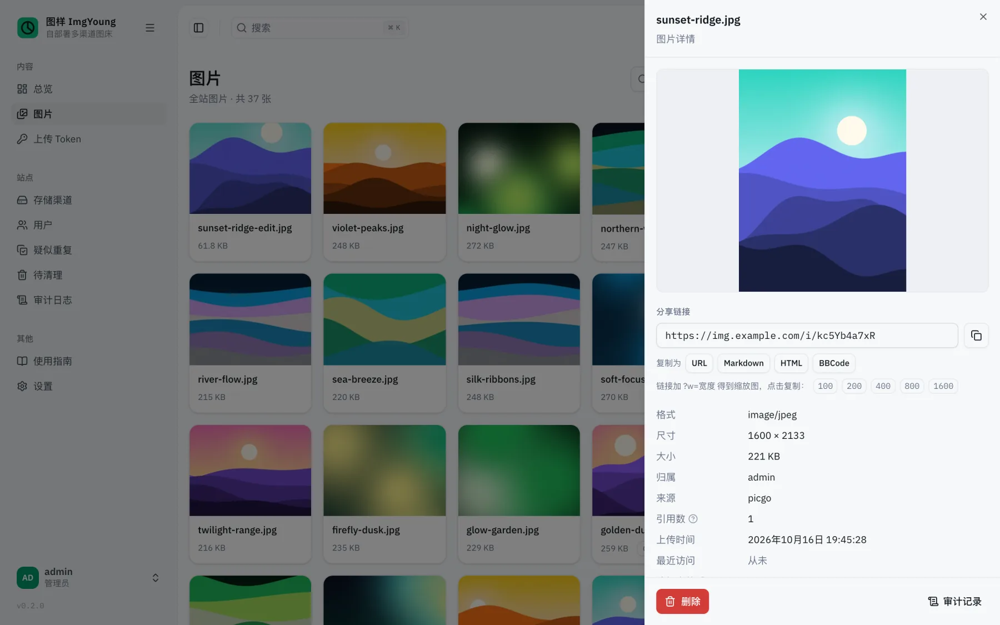
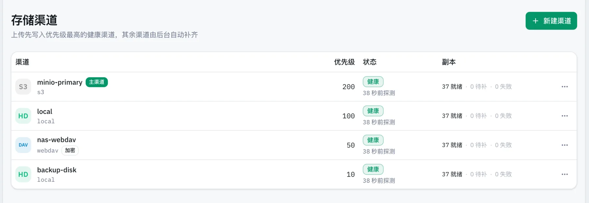
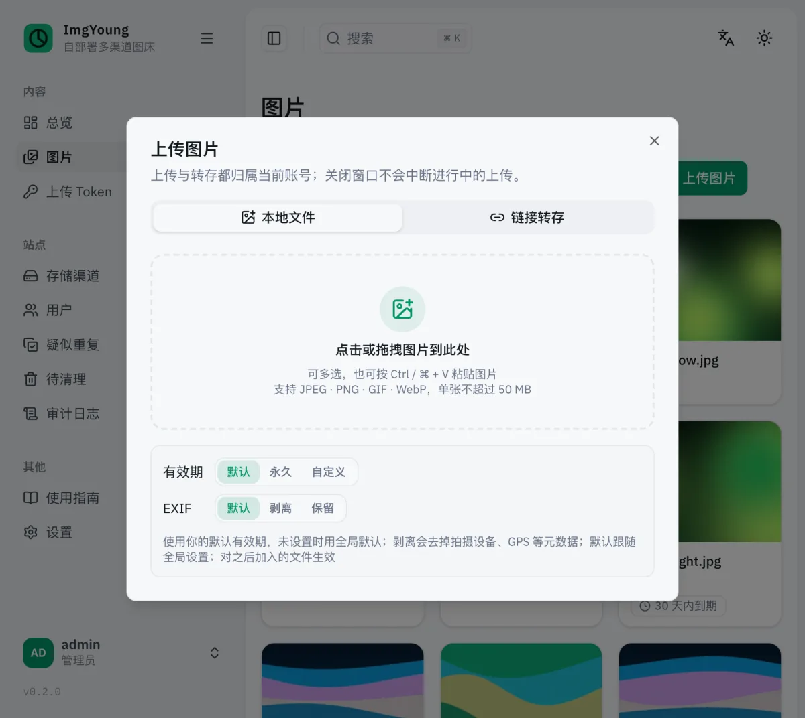
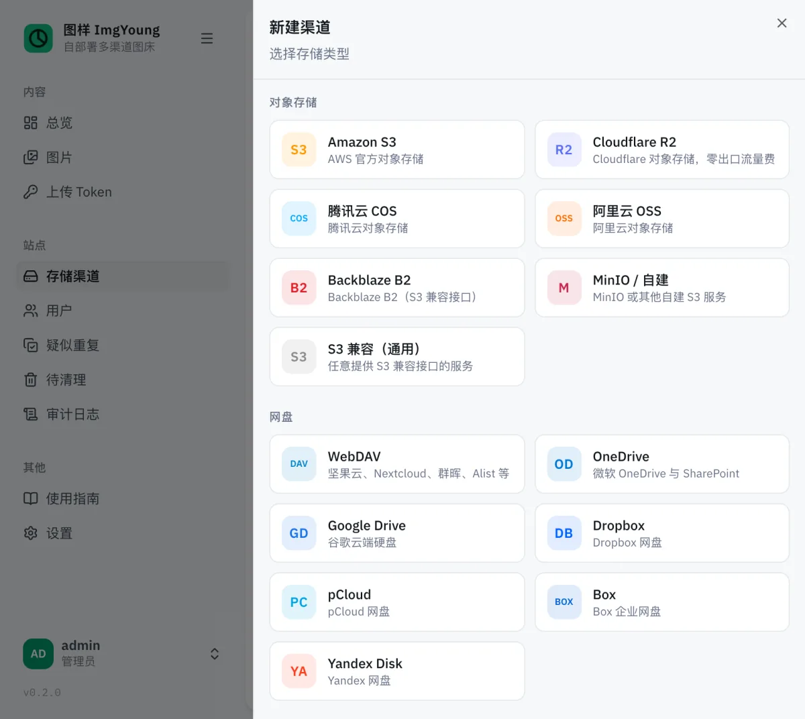

<p align="center">
  
</p>

<h1 align="center">图样 ImgYoung</h1>

<p align="center">
  <strong>多渠道主备容灾的自部署图床</strong><br>
  一张图同时存进多个存储渠道，哪个渠道出了问题，上传和访问都照常进行。
</p>

<p align="center">
  <a href="https://github.com/x-haose/imgyoung/releases"></a>
  <a href="https://github.com/x-haose/imgyoung/actions/workflows/ci.yml"></a>
  <a href="./go.mod"></a>
  <a href="https://github.com/x-haose/imgyoung/pkgs/container/imgyoung"></a>
  <a href="./LICENSE"></a>
</p>

<p align="center">
  <a href="https://imgyoung.x-haose.com/zh/docs">文档</a> ·
  <a href="#快速开始">快速开始</a> ·
  <a href="https://github.com/x-haose/imgyoung/releases">下载</a> ·
  <a href="./README.en.md">English</a>
</p>

<picture>
  <source media="(prefers-color-scheme: dark)" srcset="docs/public/screenshots/dashboard-zh-dark.webp">
  
</picture>

## 为什么选 ImgYoung

图片一旦丢了，散落在博客、文档和聊天记录里的链接就全断了。ImgYoung 只做一件事：让图不丢、链接不断。

<table>
  <tr>
    <th width="33%">图不会丢</th>
    <th width="33%">存储商看不到内容</th>
    <th width="33%">机器全毁也能恢复</th>
  </tr>
  <tr>
    <td valign="top">每张图存进多个渠道：对象存储、网盘、NAS、本地磁盘，任何 rclone 后端都可以。某个渠道故障时，上传顺延到下一个渠道，访问切到还有副本的渠道，缺的副本由后台自动补齐。</td>
    <td valign="top">渠道可以开启加密，内容和文件名都加密后才写进去。密钥由你的主密钥派生；导出渠道的 rclone 配置后，不依赖 ImgYoung 也能用标准 rclone 读出原图。</td>
    <td valign="top">元数据库定时快照到每个渠道。换一台机器，放回主密钥和一份快照，所有图片和链接都能找回来。</td>
  </tr>
</table>

## 功能

- **上传**：后台拖拽与粘贴、HTTP 接口、URL 转存、S3 兼容接口，PicGo、PicList、ShareX 可以直接接入，Typora 经 PicGo 接入；上传接口支持幂等键，客户端重试不会产生重复的图。
- **访问**：短链接 `/i/<id>` 可以交给 CDN 按一年缓存；`?w=` 按预设宽度缩放，浏览器支持时自动输出 WebP；Referer 白名单防盗链；也可以把访问 302 到渠道自己的公开地址，节省本机流量。
- **存储**：常用对象存储与网盘都有现成模板，其他 rclone 后端直接填参数；优先级决定主备；定时健康探测，故障渠道自动降级，恢复后自动启用；可以要求每次上传同步写够 N 份。
- **管理**：多用户与存储配额；具名上传 Token，可设有效期、轮转、吊销；审计日志、告警与 Webhook、Prometheus 指标；中英双语，亮色与暗色主题。
- **生命周期**：图片有效期与访问续期；长期没人访问的图进入待清理列表；字节完全相同的图自动合并，外观相似的图由管理员裁决。
- **部署**：单个二进制，纯 Go，内置 SQLite，不依赖外部数据库或缓存；支持 Docker、Docker Compose、一行安装脚本与 systemd；Linux、macOS、Windows，amd64 与 arm64。

## 截图

<table>
  <tr>
    <td width="50%">
      <picture>
        <source media="(prefers-color-scheme: dark)" srcset="docs/public/screenshots/images-zh-dark.webp">
        
      </picture>
      <p align="center">图片</p>
    </td>
    <td width="50%">
      <picture>
        <source media="(prefers-color-scheme: dark)" srcset="docs/public/screenshots/detail-zh-dark.webp">
        
      </picture>
      <p align="center">图片详情</p>
    </td>
  </tr>
  <tr>
    <td colspan="2">
      <picture>
        <source media="(prefers-color-scheme: dark)" srcset="docs/public/screenshots/channels-zh-dark.webp">
        
      </picture>
      <p align="center">存储渠道</p>
    </td>
  </tr>
  <tr>
    <td width="50%">
      <picture>
        <source media="(prefers-color-scheme: dark)" srcset="docs/public/screenshots/upload-zh-dark.webp">
        
      </picture>
      <p align="center">上传</p>
    </td>
    <td width="50%">
      <picture>
        <source media="(prefers-color-scheme: dark)" srcset="docs/public/screenshots/new-channel-zh-dark.webp">
        
      </picture>
      <p align="center">新建渠道</p>
    </td>
  </tr>
</table>

## 快速开始

用 Docker 启动：

```bash
docker run -d --name imgyoung --restart unless-stopped \
  -p 8721:8721 -v imgyoung-data:/data ghcr.io/x-haose/imgyoung:latest
```

或者在 Linux / macOS 上一行装成本机程序，装完运行 `imgyoung` 启动（Linux 上改用 `| sudo sh -s -- --service`，会注册 systemd 服务并直接启动）：

```bash
curl -fsSL https://raw.githubusercontent.com/x-haose/imgyoung/main/install.sh | sh
```

然后：

1. 浏览器打开 `http://localhost:8721/`，用 `admin` / `imgyoung123` 登录，按提示修改密码。
2. 在「存储渠道」页接入至少一个异地渠道。新实例只有本机磁盘一个渠道，接入异地渠道后，容灾才真正生效。
3. 在「上传 Token」页签发 Token，填进 PicGo / PicList，或者直接上传：

```bash
curl -H "Authorization: Bearer <Token>" -F "file=@photo.png" http://localhost:8721/api/upload
# {"id":"R0RjUyP1UW","url":"http://localhost:8721/i/R0RjUyP1UW"}
```

> [!NOTE]
> ImgYoung 目前处于 0.x 阶段，版本之间可能有不兼容的改动，升级前请先看[发布说明](https://github.com/x-haose/imgyoung/releases)。

## 支持的存储与客户端

**存储**：Amazon S3、Cloudflare R2、阿里云 OSS、腾讯云 COS、Backblaze B2、MinIO 与其他 S3 兼容服务、WebDAV（坚果云、Nextcloud、群晖等）、OneDrive、Google Drive、Dropbox、pCloud、Box、Yandex Disk 都有现成模板；rclone 支持的其他后端可以直接填写参数接入。

**客户端**：PicGo、PicList、ShareX、Typora、aws CLI、rclone、各语言的 S3 SDK，以及 curl 与自己写的脚本。配置方法见[上传客户端](https://imgyoung.x-haose.com/zh/docs/guides/clients)。

## 文档

完整文档在 <https://imgyoung.x-haose.com>：

| 章节 | 内容 |
| --- | --- |
| [安装](https://imgyoung.x-haose.com/zh/docs/install) | 一行脚本、Docker、Docker Compose、发布包、源码构建 |
| [使用指南](https://imgyoung.x-haose.com/zh/docs/guides/upload) | 上传、上传客户端、访问图片、生命周期与查重、管理后台 |
| [存储渠道](https://imgyoung.x-haose.com/zh/docs/channels) | 渠道与容灾、对象存储与 WebDAV、网盘与 OAuth、渠道存储加密 |
| [配置](https://imgyoung.x-haose.com/zh/docs/configuration) | 环境变量与后台运营配置 |
| [运维](https://imgyoung.x-haose.com/zh/docs/operations/reverse-proxy) | 反向代理与 HTTPS、CDN、备份与恢复、升级、忘记密码、监控与告警 |
| [架构](https://imgyoung.x-haose.com/zh/docs/architecture) | 设计取舍与技术选型 |
| [接口参考](https://imgyoung.x-haose.com/zh/docs/api) | 由 [api/openapi.yaml](./api/openapi.yaml) 生成 |

部署示例（Compose、Caddy、Nginx、systemd）在 [deploy/](./deploy/)；后续计划见带 [`roadmap`](https://github.com/x-haose/imgyoung/issues?q=label%3Aroadmap) 标签的 issue。

## 作为 Go 库使用

存储引擎是公开的 Go 包，可以单独引入：`store/driver` 定义存储驱动接口，`store/rclone` 用 rclone 的任一后端实现它（可叠加加密），`store/failover` 在一组驱动之上提供容灾原语：按优先级写够 N 份、读第一个读得到的、健康探测。

```bash
go get github.com/x-haose/imgyoung/store/failover github.com/x-haose/imgyoung/store/rclone
```

用法与示例见 [Go 库文档](https://imgyoung.x-haose.com/zh/docs/library)。

## 参与开发

```bash
task test   # 全量测试(含竞态检测)
task e2e    # 端到端测试:编译真实二进制、启动进程,并按 OpenAPI 文档校验每条响应
task lint   # Go、管理后台、文档站与安装脚本的检查,要求 0 问题
task docs   # 本地预览文档站
```

环境准备、代码约定、提交与发布流程见 [CONTRIBUTING.md](./CONTRIBUTING.md)。欢迎提 issue 与 PR；觉得 ImgYoung 有用，也欢迎点一个 Star。

## 致谢

ImgYoung 建立在这些开源项目之上：[rclone](https://rclone.org/)（存储后端与加密）、[River](https://riverqueue.com/)（任务队列）、[modernc.org/sqlite](https://gitlab.com/cznic/sqlite)（纯 Go 的 SQLite）、[Atlas](https://atlasgo.io/)（数据库迁移）、[chi](https://github.com/go-chi/chi)（HTTP 路由）。管理后台基于 [TanStack](https://tanstack.com/) 与 [shadcn/ui](https://ui.shadcn.com/)，并复用了 [shadcn-admin](https://github.com/satnaing/shadcn-admin) 的通用组件；文档站基于 [Fumadocs](https://fumadocs.dev/)。

## 许可证

[MIT](./LICENSE)。shadcn-admin 组件的许可证见 [web/licenses/shadcn-admin.LICENSE](./web/licenses/shadcn-admin.LICENSE)。
